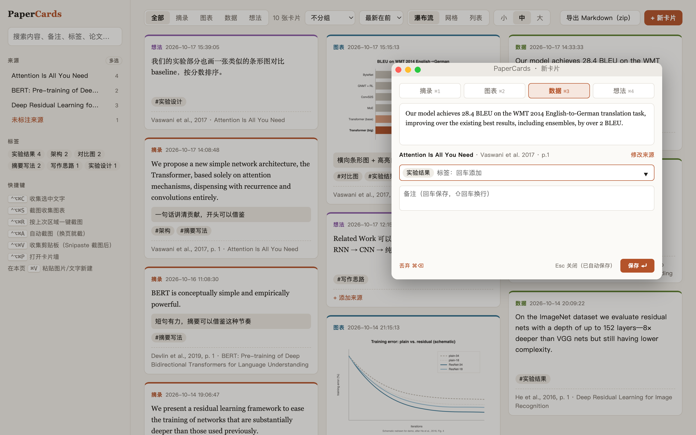
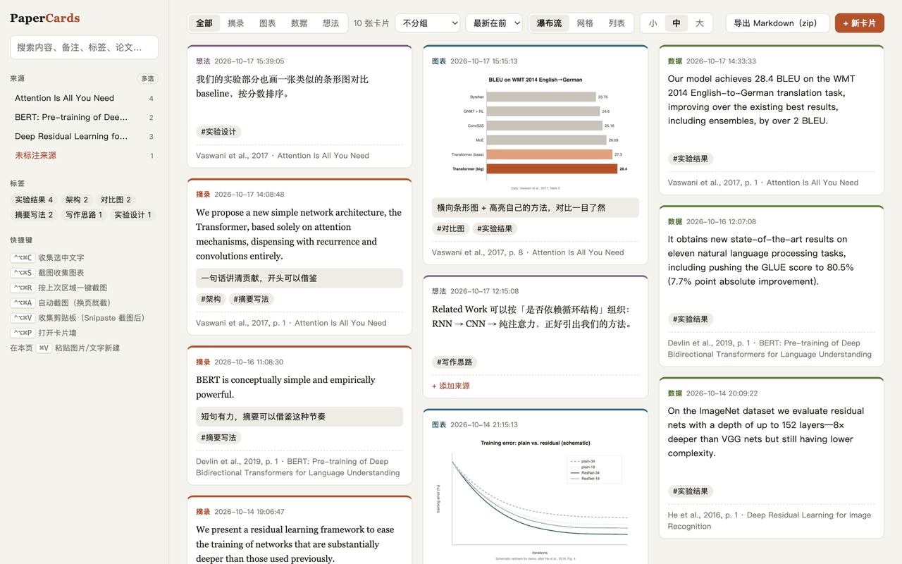
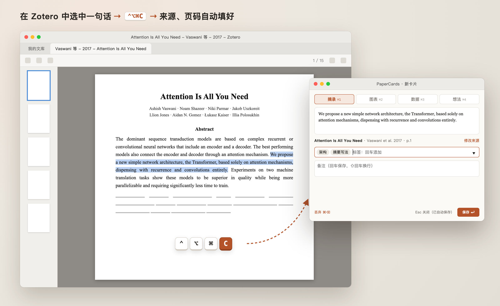
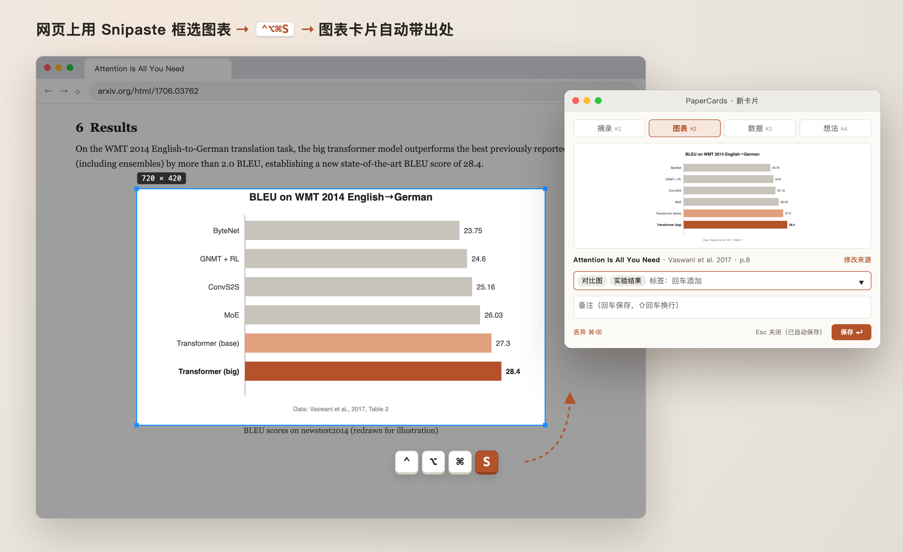

# PaperCards

[中文](README.md) | English

Collect the **great sentences, figures and numbers** you meet while reading papers or watching talks — as cards, **with their source attached automatically**.



- Select a sentence in Zotero → `⌃⌥⌘C` → a small panel pops up with title, authors, year and **page number** already filled in; add a tag, press Enter, done
- Snip a figure with Snipaste → `⌃⌥⌘V` → a figure card, source included
- Watching a live talk or lecture slides → `⌃⌥⌘A` → one screenshot per slide, automatically
- Browse, filter and search everything on a local card wall; export to Markdown with citations and BibTeX

Everything stays on your machine (SQLite + an image folder). No cloud services.

<p align="center"></p>

<sub>Screenshots use sample data: quotes and numbers are taken from the cited papers; charts are redrawn from the papers' reported values for illustration.</sub>

## How it looks in use

**Grab a sentence in Zotero**: select it → `⌃⌥⌘C`. The panel opens with the paper's title, authors, year and page already filled in; add a tag and press Enter.



**Grab a figure from a web page**: `⌃⌥⌘S` starts a Snipaste snip; when you're done, a figure card pops up with the source detected from the page (arXiv / DOI).



<sub>Illustrations: the app windows are mock-ups (UI text in Chinese); the card panel is a real PaperCards screenshot.</sub>

## Features

**Capture**

| Hotkey | Action |
|---|---|
| `⌃⌥⌘C` | Capture selected text (Zotero / Chrome / any app) |
| `⌃⌥⌘V` | Capture the selection if there is one, otherwise the clipboard (e.g. right after a Snipaste snip) |
| `⌃⌥⌘S` | Snip with Snipaste and turn it into a card |
| `⌃⌥⌘R` | Snip Snipaste's last region again in one keystroke |
| `⌃⌥⌘A` | Start / stop auto-capture: watch a region and snap whenever the slide changes |
| `⌃⌥⌘P` | Open the card wall |

**Automatic source detection**

- **Zotero**: matches the reader window to your Zotero library, with full metadata and the current page. Click a card's source to open the PDF in Zotero at that page
- **Chrome / Edge / Brave / Arc / Safari**: reads the page URL and `citation_*` meta tags; arXiv links are resolved via the arXiv API, DOIs via Crossref; if the paper is also in your Zotero library, the card links to it
- If nothing is detected, paste a DOI / arXiv ID / URL into the panel to fill it in

**Capture panel**

The cursor starts in the tag box: Enter adds a tag, Enter on an empty box jumps to the note; Enter in the note saves (⇧Enter for a new line). `⌘⏎` saves from anywhere, Esc saves and closes, `⌘1–4` switches the type (quote / figure / data / idea), `⌘⌫` discards an accidental capture.

**Auto-capture**

- The region is locked when you start (Snipaste's last region by default; re-select it with Snipaste from the 📷 menu bar item), so you can keep using Snipaste for other things
- Configurable check interval (5 s by default); after each slide change, either pop up the panel or save silently
- Silent capture with no screen flicker when Screen Recording permission is granted

**Card wall** (`http://127.0.0.1:8787`)

- **Highlights / underline** (like Zotero): select text in a card to get a toolbar with 5 highlight colors, underline and clear; click the same color again to remove it; `⌘Z` / `⌘⇧Z` undo / redo (content edits too). Exported as colored `<mark>` / `<u>`
- **Image annotation** (like Snipaste): "标注" on an image card opens an editor with rectangle, ellipse, arrow, pen, marker, text and mosaic tools, 6 colors, 3 sizes and undo / redo; the original image is kept, so annotations can be edited later or cleared
- **Source tags**: label sources with their venue, team or institution (edit via ✎ on a source; the venue can be added in one click); filter by source tag at the top of the sidebar; shown as outlined pills on each card's source line and included in exports
- Filter by source, tag and type; full-text search. Sources and tags are single-select by default, with a multi-select toggle (or ⌘-click); multiple tags can match "any" or "all"; the tag list only counts cards from the selected sources
- Group (by source / type) × sort (newest / oldest); masonry, grid, list and quad layouts; adjustable card size and a draggable sidebar
- **Quad layout**: ideas, quotes, figures and data each get their own independently scrolling pane; drag the dividers to resize (double-click to reset), switch each pane between vertical scrolling and horizontal paging, reset in one click
- Type order puts ideas first by default; drag the type buttons at the top to reorder
- **Keyboard browsing**: `←` `→` previous / next card (snapped to the top), `⌥←` `⌥→` first card of the previous / next type; in the quad layout this acts on the pane under the mouse
- Add / remove tags right on a card (with autocomplete); rename, merge or delete tags from the sidebar; double-click a card's text or click its note to edit inline (a single click expands long text)
- Paste an image or text with `⌘V` to create a card; timestamps down to the second
- Export to Markdown (a zip with images and BibTeX): sections and order follow the current view (by type / by source / flat); images are named by type and sequence, e.g. `图表-1.png` (figure-1), numbered by creation time within each type
- Save a view as a bookmark with URL parameters, e.g. `?layout=quad&q=60,50,50&tags=results` (parameters: `layout` `group` `sort` `size` `sources` `stags` `tags` `h` `q`)

## Installation

Requires macOS and:

- [Hammerspoon](https://www.hammerspoon.org/) for global hotkeys: `brew install --cask hammerspoon`
- Python 3 (the system `/usr/bin/python3` is fine; standard library only, nothing to pip install)
- Optional: [Snipaste](https://www.snipaste.com/) for screenshot features, [Zotero 7+](https://www.zotero.org/)

1. Clone the repo:

   ```bash
   git clone https://github.com/mia1460/papercards.git ~/papercards
   ```

2. Append to `~/.hammerspoon/init.lua` (adjust the path to where you cloned it):

   ```lua
   package.path = package.path .. ";" .. os.getenv("HOME") .. "/papercards/?.lua"
   papercards = require("papercards")
   ```

3. Click **Reload Config** in the Hammerspoon menu bar icon.

4. Grant Hammerspoon these permissions when prompted:
   - **Accessibility**, to read selected text
   - **Screen Recording**, for flicker-free auto-capture (optional; without it auto-capture still works but the screen flickers)

5. Optional for Chrome: enable *View → Developer → Allow JavaScript from Apple Events* so paper metadata can be read straight from the page.

Hammerspoon starts the local server automatically. You can also run `python3 server.py` and open http://127.0.0.1:8787.

## Configuration

| Environment variable | Default | Description |
|---|---|---|
| `PAPERCARDS_PORT` | `8787` | Server port |
| `PAPERCARDS_DATA` | `./data` | Data directory (card database + images) |
| `ZOTERO_DIR` | `~/Zotero` | Zotero data directory |

## How it works

```
Hammerspoon (papercards.lua)            server.py (127.0.0.1:8787)
  hotkey → selected text / snip    ──▶    source lookup: Zotero library (read-only) / arXiv / Crossref
  detect window, page URL                  stored in SQLite + image folder
  capture panel (static/quick.html) ◀──   card wall (static/index.html)
```

- The paper and page currently open in Zotero are inferred from the window title plus the `.zotero-reader-state` file in each attachment folder; `zotero.sqlite` is opened read-only and your Zotero library is never modified
- Snips go through the Snipaste CLI (`snip --last -o file`); auto-capture reads the region from Snipaste's log and takes silent shots with the system `screencapture`

## License

MIT
